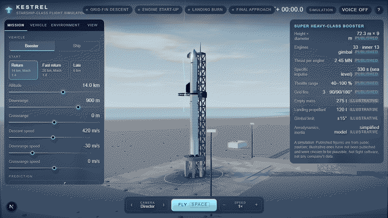
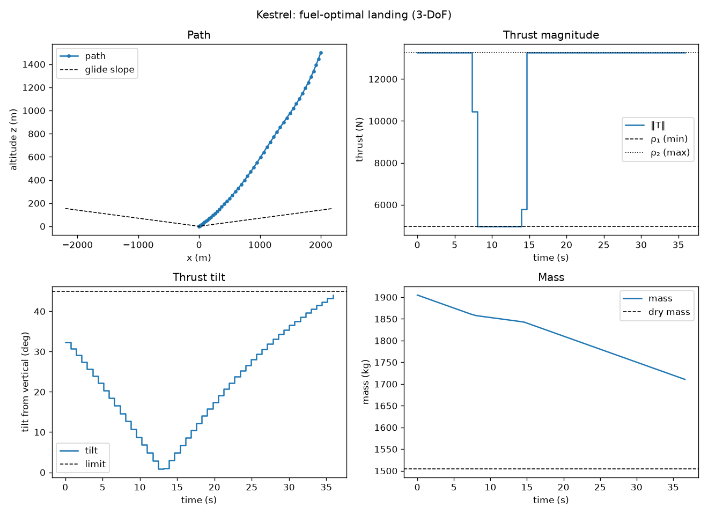

# Kestrel

**Land a Starship-class rocket in your browser, guided live by real
landing-guidance maths, then break it on purpose and watch it recover.**

[](https://moazzamaliakamonad-byte.github.io/KESTREL/)

[](https://github.com/moazzamaliakamonad-byte/KESTREL/actions/workflows/ci.yml)
[](LICENSE)


A Super Heavy-class booster falls back from the edge of space engines
first, steers with grid fins, lights thirteen engines, drops to three
and is **caught by the tower's arms**. The ship belly-flops in from
orbit, flips under guidance and is caught too. Every landing burn is
planned live, and re-planned up to twice a second, by **successive convexification**,
the class of convex-optimization algorithm used for real propulsive
landings, written in **Rust**, compiled to **WebAssembly**, and solved by
**Kestrel's own interior-point solver**, written from scratch for this
project.



<sub>Recorded from the page (`web/scripts/record-demo.mjs`), frames taken at
moments of the flights, so it runs faster than real time; the ascent and
staging at the start are an illustration, the rest is simulated.</sub>

## Break it

- **Fail engines mid-burn.** Click any engine on the engine map. Guidance
  re-plans at once; the booster re-plans its whole burn on the engines it
  has left (caught in all 320 flights of the engine-out test board), and
  a ship whose engine dies lights a spare.
- **Throw wind and gusts at it.** Guidance estimates the wind in flight
  and plans with it; in a crosswind the ship turns its whole approach
  toward where the wind is carrying it.
- **Pause anywhere and open the blueprint.** The vehicle turns into a
  wireframe on blue, every part is clickable, and its calculations open
  beside it: the simulator's own formulas with this instant's numbers.
- **Replay any instant** with every decision guidance made and why.
- **Come in from orbit**: a guided entry from 120 km at 7.5 km/s, with
  heat-shield tiles that can burn through, handed over to the landing.

## Why it is interesting

- **The real algorithm, not an animation.** Each plan is a 6-DoF
  trajectory optimization: linearize the dynamics around the last
  trajectory, solve a second-order cone program (SOCP) for a better
  one, repeat (Szmuk & Açıkmeşe, 2018). The page re-plans whenever the
  vehicle drifts off its plan or something happens.
- **Its own solver.** `crates/socp` is a primal-dual interior-point SOCP
  solver with Nesterov-Todd scaling, infeasibility certificates, no
  memory allocation while solving and a fixed iteration cap, as flight
  code needs. It is the only solver in the page (a reference solver,
  Clarabel, is used in tests only). Benchmarks:
  [LIMITATIONS.md](LIMITATIONS.md).
- **Guidance never sees the truth.** A separate 6-DoF simulator owns the
  real state (engine ignition delay, throttle lag, gimbal limits,
  atmosphere, wind, the tower); guidance flies on noisy, drifting sensor
  readings through a navigation filter.
- **Every number is measured.** Changes are scored on boards of hundreds
  of seeded flights before they are kept, and the ones that did not help
  are written down too ([docs/DECISIONS.md](docs/DECISIONS.md)). In the
  latest wind sweep, 163 of 216 flights from still air to 25 m/s
  crosswinds were caught.

This is a **simulation**, built from public figures: published numbers
are cited and marked, unpublished ones are marked *illustrative*. It is
not flight software and not any company's data, and it is not affiliated
with or endorsed by SpaceX. See [LIMITATIONS.md](LIMITATIONS.md).

Named after the kestrel, the small falcon that hovers motionless in a
headwind before it drops onto a precise spot.

## Run it locally

Needs Node 22+, Rust with the `wasm32-unknown-unknown` target and
`wasm-bindgen-cli` 0.2.130 (one-time setup: [docs/SETUP.md](docs/SETUP.md)).

```sh
cd web && npm install && npm run dev      # → http://localhost:3000
```

`npm run dev` compiles the Rust simulator and guidance to WebAssembly
first, then serves the page. Press **Fly** (or Space): a countdown,
liftoff and stage separation play (an illustration; the ascent is not
simulated), then the simulated return begins. **Space** pauses, **A**
opens the analysis view, **1–6** change camera, **,** and **.** change
the speed. The left dock holds every setting (mission, vehicle,
environment, view); click an engine on the engine map to fail it. After
a booster catch you can fly the ship's return to the same tower.

## How it works

1. **Truth.** A 6-DoF rigid-body simulator (Rust) owns the vehicle's real
   state: engines with ignition delay, throttle lag, gimbal limits and
   failures; flaps or grid fins; cold-gas thrusters; an exponential
   atmosphere, wind and gusts; the tower, its arms and the ground.
2. **Sensing.** Guidance never reads the truth, only a noisy, slowly
   drifting estimate of it, blended by a navigation filter, plus a wind
   estimate it keeps updating in flight.
3. **Unpowered flight.** The booster leans a few degrees to fly on body
   lift, the ship changes its pitch in the belly flop; both steer to the
   point where the engines must light, found by integrating the fall.
4. **Landing burn.** Successive convexification: one convex SOCP per
   iteration, solved by Kestrel's own solver in a Web Worker. The
   booster's burn is one plan with its 13 → 3 engine switch inside it; a
   tracking controller flies the plan between re-plans.
5. **Final approach.** A controller glides the vehicle onto the catch
   axis and the arms in one movement.
6. **Front end.** Next.js (static export) + React Three Fiber. Everything
   on screen is procedural: no image, model or sound files except the
   commentary clips, rendered from the phrase list by an open
   text-to-speech model, Kokoro-82M (Apache-2.0; see
   `web/scripts/make-voice.mjs`).

The first milestones' 3-DoF guidance (lossless convexification) is still
in the repository and tested; the page no longer uses it.

Longer version: [docs/ARCHITECTURE.md](docs/ARCHITECTURE.md). Every design
decision, including the ones that were measured and dropped:
[docs/DECISIONS.md](docs/DECISIONS.md).

## Repository map

| Path | What |
| --- | --- |
| `crates/model` | vehicle and planet constants, aerodynamics, rigid-body equations |
| `crates/sim` | the simulator: true state, engines, disturbances, sensors |
| `crates/guidance` | convex guidance: 3-DoF lossless convexification, 6-DoF successive convexification, controllers |
| `crates/socp` | Kestrel's own interior-point SOCP solver |
| `crates/wasm` | the WebAssembly bridge and the flight logic the page runs |
| `web/` | the page: Next.js, React Three Fiber, the console and analysis view |

## Status

- **M0–M3 done:** fuel-optimal 3-DoF guidance in a closed loop; 6-DoF
  vehicles (ship and booster) with tower catches; one page with
  cinematic cameras, the blueprint analysis view, commentary and sound;
  a navigation filter; an engine-out envelope; Kestrel's own solver with
  a published benchmark; a guided entry from orbit.
- **M4, smarter guidance:** wind estimated in flight and used by plans
  and controllers; a gliding final approach; a chosen approach bearing in
  crosswinds; Kestrel's own solver the only one that flies; the booster's
  burn planned as one with the engine switch inside it.
- **Scope:** the landing guidance. The launch, ascent, hot staging and
  boostback are not simulated; the opening sequence is an illustration.

Plan and open items: [docs/ROADMAP.md](docs/ROADMAP.md). Measured numbers
and every known approximation: [LIMITATIONS.md](LIMITATIONS.md).

## Offline (Rust only)

```sh
cargo test
cargo run --release -p kestrel-guidance --example land_once > target/landing.csv
python scripts/plot_trajectory.py target/landing.csv target/landing.png   # needs matplotlib
```



## Tests

```sh
cargo test                      # Rust: guidance, solver, simulator, WASM bridge, closed-loop flights
cd web && npm test              # TypeScript unit tests (Vitest)
cd web && npm run e2e           # opt-in: real-browser end-to-end tests (Playwright)
```

The long measurement boards (hundreds of flights each) are `#[ignore]`d
and run on demand, e.g.
`cargo test --release -p kestrel-wasm --test ship_loop wind_sweep -- --ignored --nocapture`.

## Contributing

Issues and pull requests are welcome: bugs, sharper guidance, better
visuals, more tests. Start with [CONTRIBUTING.md](CONTRIBUTING.md).

## Honest ceiling

This is a **simulation only**. Real flight software needs flight
hardware, hardware-in-the-loop testing and certification, none of which
this project has. See [LIMITATIONS.md](LIMITATIONS.md).

## License

MIT. See [LICENSE](LICENSE). If you use Kestrel in your work, GitHub's
"Cite this repository" button gives a citation ([CITATION.cff](CITATION.cff)).
