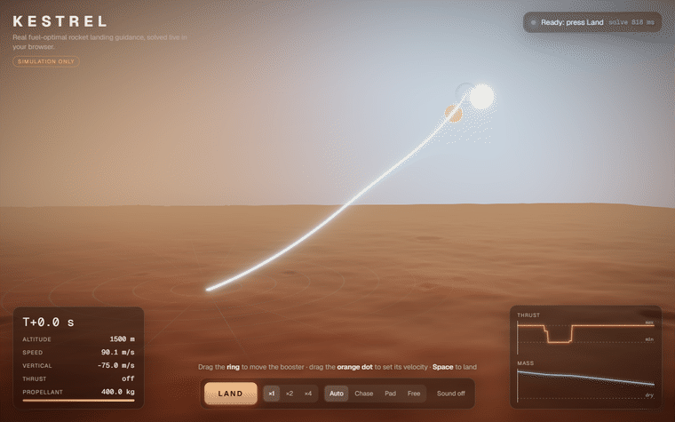

# Kestrel

**A Starship-class flight simulator in a browser tab.** A Super Heavy-class
booster falls back from the edge of space engines first, steers with three
grid fins, lights thirteen engines, drops to three and is caught by the
tower's arms. The ship belly-flops in, flips and is caught too. The landing burns are planned live by the class of algorithm
used for real propulsive landings (successive convexification, a sequence of
convex optimizations), in Rust compiled to WebAssembly. Change anything,
fail any engine, throw gusts at it, pause it mid-air and switch to the
analysis view: the vehicle becomes a blueprint, every part can be clicked,
and its calculations (the simulator's own formulas with this instant's
numbers) open beside it. Step the paused flight a tenth of a second at a time.

This is a **simulation**, built from public figures: published numbers are
cited and marked, unpublished ones are marked *illustrative*. It is not
flight software and not any company's data. See
[LIMITATIONS.md](LIMITATIONS.md).



<sub>The recording above is the first milestone's page (a 3-DoF lander on
Mars); the current page has not been re-recorded yet.</sub>

Named after the kestrel, the small falcon that hovers motionless in a headwind
before it drops onto a precise spot.

## Run it

Needs Node 22+, Rust with the `wasm32-unknown-unknown` target and
`wasm-bindgen-cli` 0.2.130 (one-time setup: [docs/SETUP.md](docs/SETUP.md)).

```sh
cd web && npm install && npm run dev      # → http://localhost:3000
```

`npm run dev` compiles the Rust simulator and guidance to WebAssembly first,
then serves the page. Press **Fly** (or Space): a countdown, liftoff and
stage separation play (an illustration; the ascent is not simulated), then
the simulated return begins. **Space** pauses, **A** opens the analysis
view, **1–6** change camera, **,** and **.** change the speed. The left dock
holds every setting (mission, vehicle, environment, view); click an engine
on the engine map to fail it. After a booster catch you can fly the ship's
return to the same tower.

## Status

- **M0–M2 done:** fuel-optimal 3-DoF landing guidance (lossless
  convexification, Clarabel), in the browser, in a closed loop with a
  separate simulator, noisy sensing and "break it" controls.
- **M3 in progress:** 6-DoF vehicles and successive convexification.
  Built: the ship (belly flop, flip, tower catch),
  the booster (grid-fin descent, 13 → 3 engine landing burn, tower catch),
  one page with full customization, cinematic cameras, the blueprint
  analysis view with per-part calculations, commentary and sound. Not built: a simulated ascent, hot staging and
  boostback (the opening sequence is an illustration), orbital entry, the
  custom solver and its benchmark.

Measured numbers and every known approximation:
[LIMITATIONS.md](LIMITATIONS.md). Plan: [docs/ROADMAP.md](docs/ROADMAP.md).

## How it works (short version)

1. **Truth.** A 6-DoF rigid-body simulator (Rust) owns the vehicle's real
   state: engines with ignition delay, throttle lag, gimbal limits and
   failures; flaps or grid fins; cold-gas thrusters; an exponential
   atmosphere, wind and gusts; the tower, its arms and the ground.
2. **Sensing.** Guidance never reads the truth, only a noisy, slowly
   drifting estimate of it.
3. **Unpowered flight.** The booster leans a few degrees to fly on body
   lift, the ship changes its pitch in the belly flop; both steer to the
   point where the engines must light, found by integrating the fall.
4. **Landing burn.** Successive convexification (Szmuk & Açıkmeşe 2018):
   linearize the 6-DoF dynamics around the last trajectory, solve one
   convex second-order cone program for a better one, repeat. Re-planned
   in a Web Worker whenever the vehicle drifts off its plan; a tracking
   controller flies the plan in between.
5. **Final approach.** A slow, simple controller slides the vehicle over
   the catch axis and lowers it onto the arms (or its legs).
6. **Front end.** Next.js (static export) + React Three Fiber. Everything
   on screen is procedural: no image, model or sound files except the
   commentary clips, which are rendered from the phrase list by an open
   text-to-speech model (see `web/scripts/make-voice.mjs`).

The first milestones' 3-DoF guidance (lossless convexification) is still in
the repository and tested; the page no longer uses it.

Longer version: [docs/ARCHITECTURE.md](docs/ARCHITECTURE.md).

## Offline (Rust only)

```sh
cargo test
cargo run --release -p kestrel-guidance --example land_once > target/landing.csv
python scripts/plot_trajectory.py target/landing.csv target/landing.png   # needs matplotlib
```


## Tests

```sh
cargo test                      # Rust: guidance, simulator, WASM bridge, closed-loop scenarios
cd web && npm test              # TypeScript unit tests (Vitest)
cd web && npm run e2e           # opt-in: real-browser end-to-end tests (Playwright)
```

## Honest ceiling

This is a **simulation only**. Real flight software needs flight hardware,
hardware-in-the-loop testing and certification, none of which this project has.
See [LIMITATIONS.md](LIMITATIONS.md).

## License

MIT. See [LICENSE](LICENSE).
